# IRON STORM — Roblox 用メタルドラムセット 3D モデル

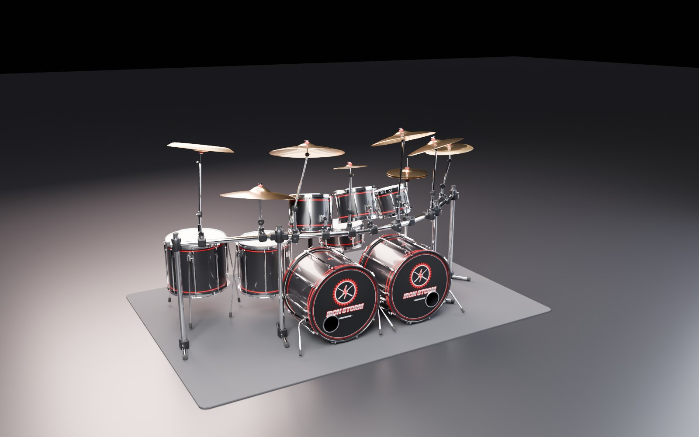

ツーバス（バスドラム 2 台）、3 面カーブラック、チャイナスタックまでそろえたメタル向けドラムセットです。
すべて Python で手続き的に生成しており、Roblox Studio の 3D インポーターでそのまま読み込めます。

| ドラマー視点 | 足元（ツインペダル） |
| --- | --- |
| 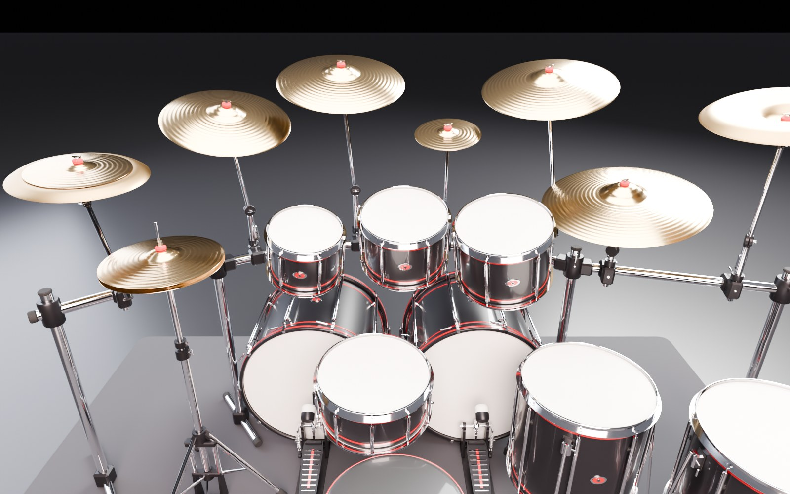 | 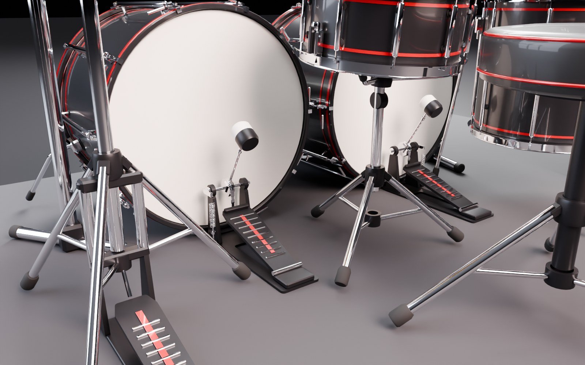 |
| 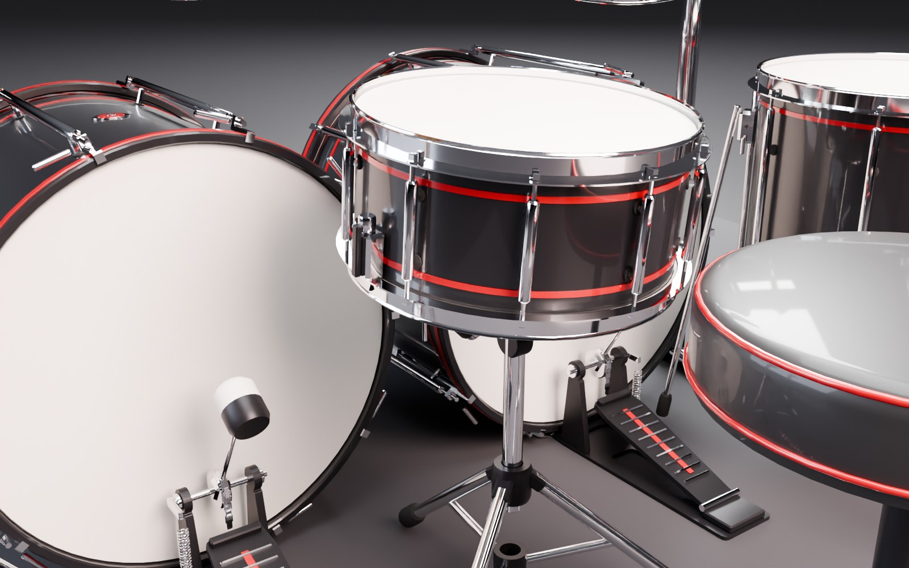 | 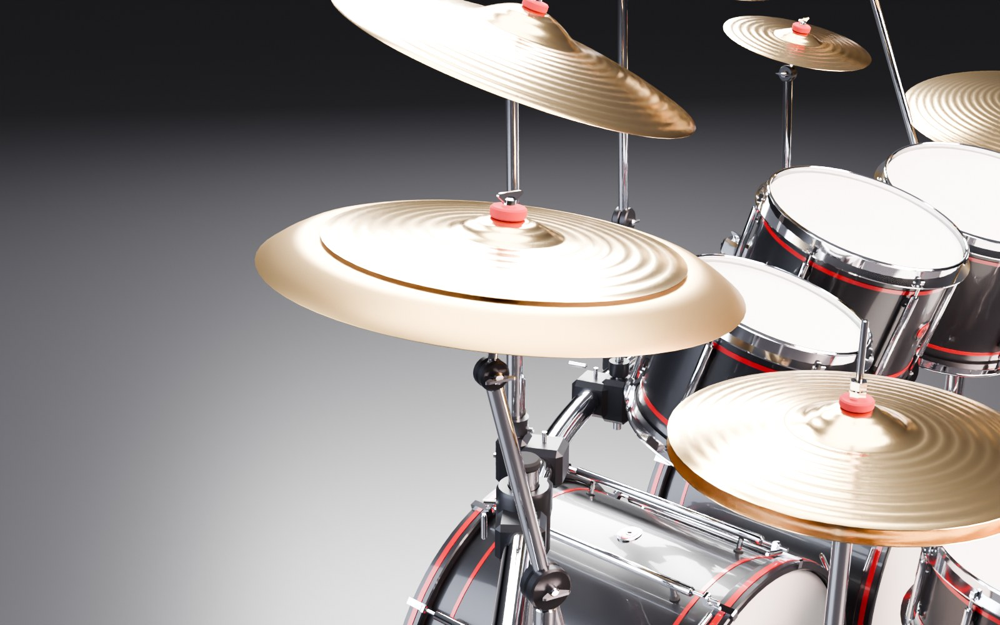 |

## Beat Drummer 用（タム 3 つの版）

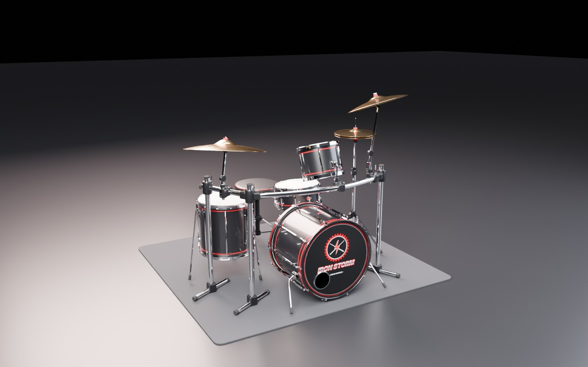

Beat Drummer の今のキットと同じ、タム 3 つ（HT・LT・FT）の構成に合わせた、購入用キット向けの版です。
画面のキー（HH・CY・SL・SR・BD・HT・LT・FT・RD）に 1 対 1 で対応します（SL / SR は同じスネア）。
ツインペダル、ラック、ロゴ入りのフロントヘッドはそのままで、スマホ向けに軽くしています（63,456 ポリゴン / MeshPart 83 個）。

- モデル: `export/beatdrummer/BeatDrummer_IronStorm.fbx`（OBJ もあり）
- セットアップ: `export/beatdrummer/BeatDrummer_IronStorm_Setup.lua`（Lane 属性と回転の中心も設定）
- 叩いたときの動き: `roblox/DrumKitFX.lua`
- 色と模様の切り替え: `roblox/DrumKitStyles.lua`（シェルの色 10 種 × 模様 7 種、差し色・金物・シンバル・ヘッド、プリセット 8 種）
- 模様とロゴの画像: `export/styles/`（Roblox にアップロードして `DrumKitStyles.lua` に ID を入れる）
- 構成の設定: `generator/specs/beatdrummer_spec.json`（パーツを増減して `kitspec.py` で作り直せます）
- ゲームへの組み込み手順（PC の Claude Code 向け）: [`BEAT_DRUMMER_HANDOFF.md`](BEAT_DRUMMER_HANDOFF.md)

### 色と模様のプリセット

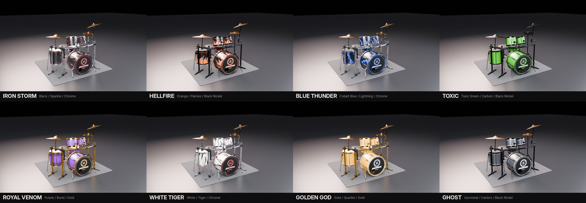

模様は、透明な部分にシェルの色が見える画像なので、どの色とも組み合わせられます
（スパークル、ファイヤー、タイガー、カーボン、バースト、ライトニング、ソリッド）。

## SOVEREIGN（スタンダードの最高峰）

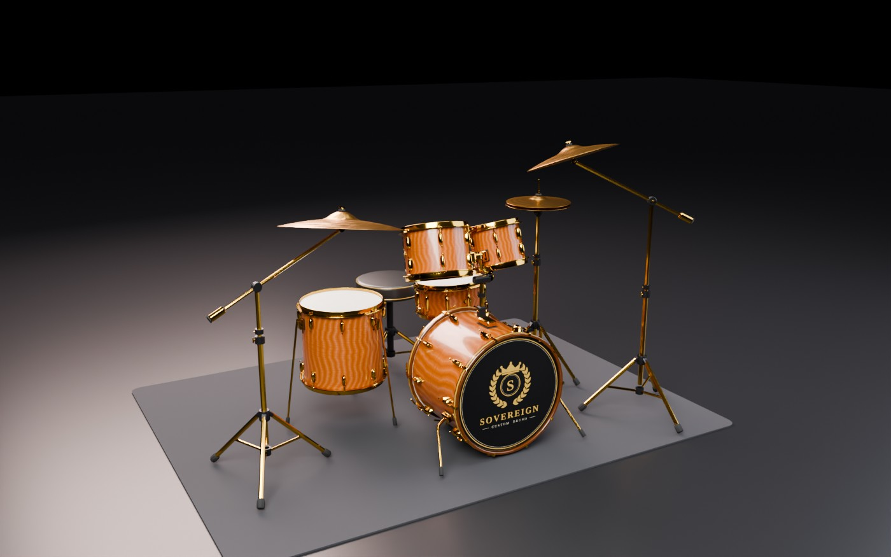

Beat Drummer 用の 2 台目のキットです。IRON STORM と同じ 9 キー・タム 3 つ（HT・LT・FT）の構成で、
置き場所もそろえてあるので、そのまま入れ替えられます（70,464 ポリゴン / MeshPart 69 個）。

- 杢目の突板（トラ杢メイプル、バーズアイ、バール、キルト、マッカーサーなど）とピアノラッカー仕上げ
- ゴールド金物、ビーバーテイル型のラグ、ダイキャストフープ
- ラックを使わず、シンバルはブームスタンド、タムはバスドラム上のタムホルダーに取り付け
- シングルペダル、穴なしのエンブレム入りフロントヘッド、槌目（ハンマリング）のシンバル

| ドラマー視点 | タムホルダー | 足元 |
| --- | --- | --- |
| 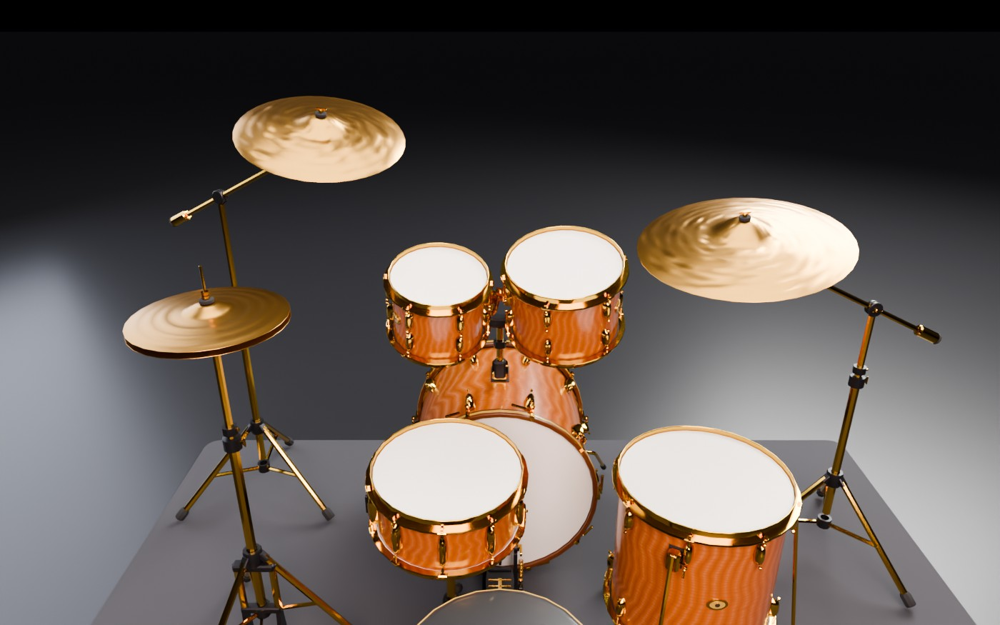 | 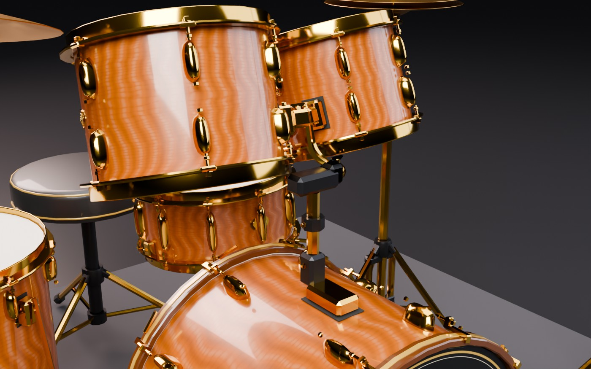 | 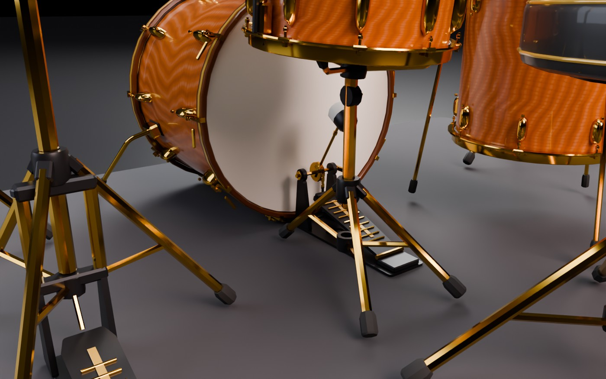 |

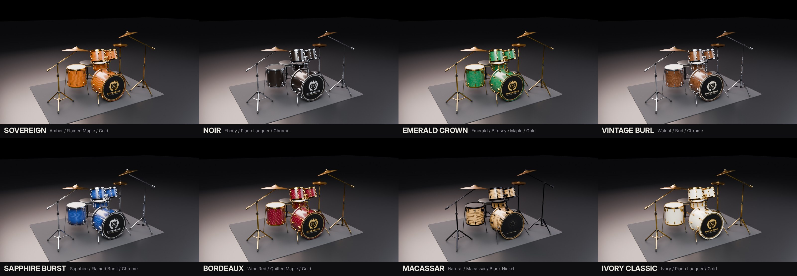

- モデル: `export/sovereign/BeatDrummer_Sovereign.fbx`（OBJ もあり）
- セットアップ: `export/sovereign/BeatDrummer_Sovereign_Setup.lua`（`KitId = "Sovereign"` の属性も付けます）
- 杢目とロゴの画像: `export/styles/sovereign/`
- 構成の設定: `generator/specs/sovereign_spec.json`
- 色と模様の切り替えは IRON STORM と同じ `roblox/DrumKitStyles.lua` で、Model の `KitId` 属性からキットを見分けます。
  選択肢は `generator/styles_catalog.json` にまとめてあり、`python make_styles_lua.py` で Lua を作り直せます

## スティック（6 種）

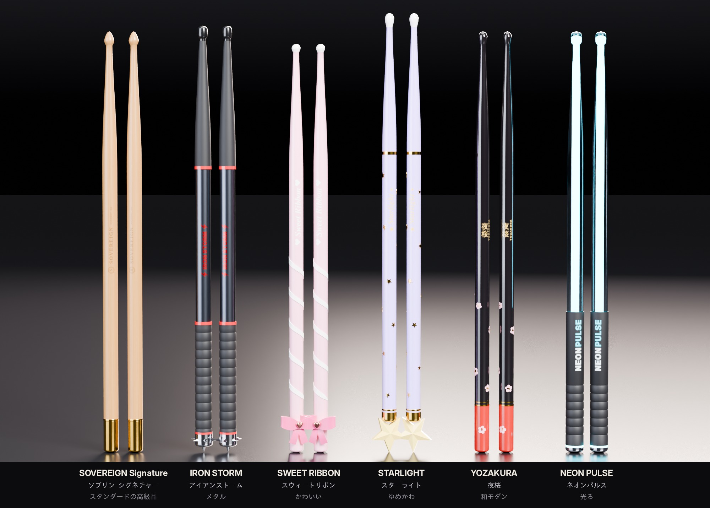

Beat Drummer で演奏するキャラクターに持たせるスティックです。キットとは別に選べます。

| スティック | テーマ | 特徴 |
| --- | --- | --- |
| SOVEREIGN Signature（ソブリン シグネチャー） | スタンダードの高級品 | ヒッコリー 5A、ゴールドディップのエンド、金箔ロゴ、どんぐり型チップ |
| IRON STORM（アイアンストーム） | メタル | ガンメタル合金、溝付きラバーグリップ、赤いライン、スパイク付きエンド |
| SWEET RIBBON（スウィートリボン） | かわいい | パステルピンク、キャンディストライプ、ハート付きリボン |
| STARLIGHT（スターライト） | ゆめかわ | ラベンダーに金の星、エンドに大きな星 |
| YOZAKURA（夜桜） | 和モダン | 黒漆、朱のエンド、金の輪、桜 |
| NEON PULSE（ネオンパルス） | 光る | 透明なシャフトの芯が光る（5 色） |

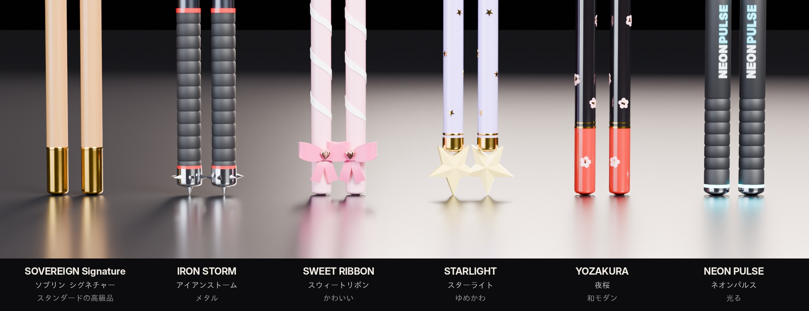

- モデル: `export/sticks/DrumSticks.fbx`（6 種が 1 列。ロゴ画像を埋め込み済み。1 本 1,720〜4,116 ポリゴン）
- セットアップ: `export/sticks/DrumSticks_Setup.lua`（色・溶接・持つ位置の Attachment）
- 手に持たせる・叩いたときに光らせる: `roblox/DrumSticks.lua`
- 生成: `generator/sticks.py`（形と色）、`stick_logos.py`（ロゴ）、`sticks_blender.py`（FBX とレンダリング）
- 組み込み手順: [`BEAT_DRUMMER_HANDOFF.md`](BEAT_DRUMMER_HANDOFF.md) の「10. スティック」

## ギターとベース（各 5 本）

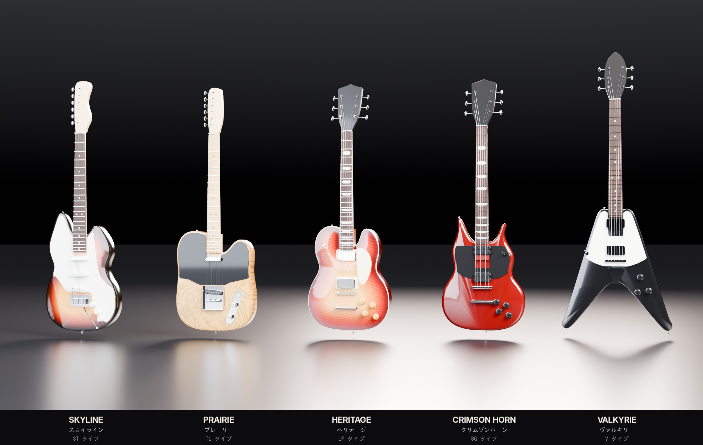
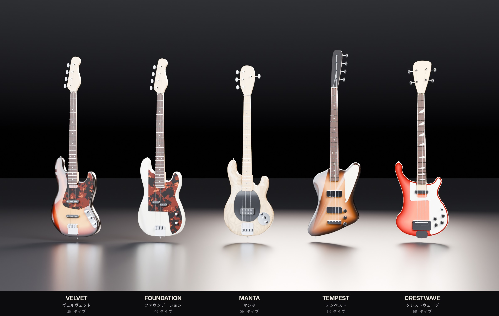

Beat Drummer のバンドのメンバーが構えるギター 5 本とベース 5 本です。代表的なモデルの形に合わせていますが、
ブランド名やロゴは入れていません（ヘッドの形も一般的な形）。
輪郭は実物の寸法の比率に合わせ、ST タイプと JB・PB・SR タイプには腕とお腹が当たる部分を削ったコンター（アームコンター・ボディ裏のカット）も付けています。

| 名前 | タイプ | 名前 | タイプ |
| --- | --- | --- | --- |
| SKYLINE | ST タイプ（ギター） | VELVET | JB タイプ（ベース） |
| PRAIRIE | TL タイプ（ギター） | FOUNDATION | PB タイプ（ベース） |
| HERITAGE | LP タイプ（ギター） | MANTA | SR タイプ（ベース） |
| CRIMSON HORN | SG タイプ（ギター） | TEMPEST | TB タイプ（ベース） |
| VALKYRIE | V タイプ（ギター） | CRESTWAVE | RK タイプ（ベース） |

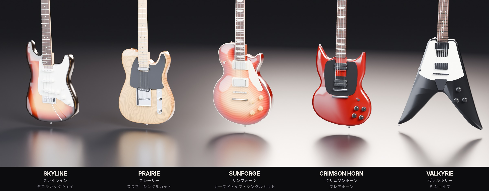

- モデル: `export/instruments/BandInstruments.fbx`（10 本が 2 列。柄の画像を埋め込み済み。1 本 6,156〜9,276 ポリゴン）
- セットアップ: `export/instruments/BandInstruments_Setup.lua`（色・溶接・構える位置の Attachment）
- キャラクターに構えさせる・ノーツに合わせて揺らす: `roblox/BandInstruments.lua`
- 生成: `generator/instruments.py`（形）、`instrument_textures.py`（サンバーストや木目）、`instruments_blender.py`（FBX とレンダリング）
- ボディ・ヘッド・ピックガードの形は実物の写真から輪郭を取り、スケール長とフレット位置で寸法を合わせています（`OUTLINES_IN`）
- 組み込み手順: [`BEAT_DRUMMER_HANDOFF.md`](BEAT_DRUMMER_HANDOFF.md) の「11. ギターとベース」

## 構成（ショーケース版）

| 区分 | 内容 |
| --- | --- |
| ドラム | バスドラム 22"×18" ×2（ポート穴・ロゴ入りフロントヘッド）、スネア 14"×6.5"（ストレイナー・響き線）、タム 10" / 12" / 13"、フロアタム 16" / 18" |
| シンバル | ハイハット 14"（クラッチ付き）、クラッシュ 18" / 19" / 20"、ライド 22"、チャイナ 18"（逆さ取り付け）、スプラッシュ 10"、スタック（チャイナ 16" + スプラッシュ 12"） |
| ハードウェア | 3 面カーブラック（クランプ・T 字脚）、シンバルブーム ×7、タムホルダー ×3、ツインペダル（チェーン・スプリング・ビーター）、ハイハットスタンド、スネアスタンド、ドラムスローン、ドラムラグ |

ディテール: チューブラグ・テンションロッド・ワッシャー、バスドラムのクロー＆T ロッド、トリプルフランジフープ、
シェルのバッジとエアベント、シンバルのレイズ（旋盤溝）表現、フェルト・ウイングナット、ペダルのチェーンとコイルスプリング など。

## ファイル

| ファイル | 説明 |
| --- | --- |
| `export/MetalDrumKit.fbx` | **おすすめ**。標準版（219,336 ポリゴン / 128 MeshPart）。ロゴ画像を埋め込み済み |
| `export/MetalDrumKit.obj` + `.mtl` + `kick_logo.png` | 同じモデルの OBJ 版（3 ファイルを同じフォルダに置いて読み込む） |
| `export/MetalDrumKit_Lite.fbx` / `.obj` | 軽量版（105,184 ポリゴン）。モバイル向けや複数台置くとき用 |
| `export/MetalDrumKit.glb` | glTF 版（メートル単位）。Roblox 以外のツールでの確認用 |
| `export/kick_logo.png` | バスドラム前面ヘッドのロゴ（1024×1024） |
| `roblox/DrumKitSetup.lua` | 読み込み後に実行するセットアップスクリプト |
| `generator/` | モデルを生成した Python スクリプト一式 |

## Roblox Studio への読み込み手順

1. Studio で **ホーム > 3D をインポート**（Import 3D）を開き、`export/MetalDrumKit.fbx` を選ぶ。
2. インポート画面のプレビューでサイズを確認する。
   正しく読み込めていれば **幅 約 10.7 × 高さ 約 5.5 × 奥行き 約 7.5 studs**（ラグ込み）です。
   極端に小さい／大きい場合は、インポート設定の **File Dimensions（ファイルの寸法）を `Studs`** にしてください。
3. 「インポート」を押すと、128 個の MeshPart が入った Model がワークスペースに追加されます。
4. エクスプローラーでその Model を選択し、**表示 > コマンドバー** に `roblox/DrumKitSetup.lua` の中身をすべて貼り付けて Enter。
   - パーツ名の末尾（`_Chrome`、`_Bronze` など）から色とマテリアルを自動設定
   - `Drums` / `Cymbals` / `Hardware` ごとに Model を整理
   - 全パーツを Anchored にし、当たり判定はラグだけ（軽量化）
   - スローンに見えない `Seat` を追加（座るとスネア側を向きます）
5. プレイテストして、スローンに座れることを確認してください。

> フロントヘッドのロゴが表示されない場合は、`export/kick_logo.png` を画像としてアップロードし、
> `DrumKitSetup.lua` 冒頭の `LogoTextureId` にその ID（`rbxassetid://...`）を入れて再実行してください。

## カスタマイズ

- **色を変える**: `DrumKitSetup.lua` の `PALETTE` を書き換えて再実行（何度実行しても OK）。
  例: `Finish`（シェル）を赤にすれば赤いキットに、`Accent` を `NeonAccents = true` にすると赤いラインが発光します。
- **パーツ名**: `<部品>_<素材>` の形式です（例: `Kick_L_Chrome`、`Crash_18_Bronze`、`Pedal_R_Beater_Chrome`）。
  シンバル（`Crash_18` など）、ハイハットのトップ（`HiHat_Top`）、ペダルのビーター（`Pedal_L_Beater`）は独立した Model なので、
  叩いたときに揺らす・動かすアニメーションを付けやすくしてあります。
- **向き・スケール**: ドラマーは −Z 方向（Roblox の正面方向）を向いています。スケールは 1 stud = 0.28 m。
  大きさを変えたいときは Model を選んで `Model:ScaleTo()` やスケールツールを使ってください。

## 仕様

| 項目 | 標準版 | 軽量版 |
| --- | --- | --- |
| ポリゴン数 | 219,336 | 105,184 |
| MeshPart 数 | 128 | 128 |
| 1 MeshPart の最大ポリゴン数 | 9,072（Roblox 上限 20,000） | 4,876 |
| サイズ | 10.7 × 5.5 × 7.5 studs（3.0 × 1.55 × 2.1 m） | 同じ |
| スローン座面の高さ | 2.0 studs | 同じ |

## 再生成

```bash
cd generator
pip install numpy scipy shapely trimesh mapbox_earcut pillow   # OBJ とロゴ
pip install bpy                                                # FBX / GLB / レンダリング用（Blender モジュール）
./build_all.sh            # すべて書き出し（3 キット、スティック、ギターとベース。RENDER=0 でレンダリングを省略）
python drumkit.py --detail 0.7 --name MyKit --out ../export    # 細かさを変えた OBJ を作る
```

`drumkit.py` の `build_kit()` 内で配置（タムの角度、シンバルの位置や大きさなど）を、
`make_logo.py` でロゴのデザインを変更できます。
